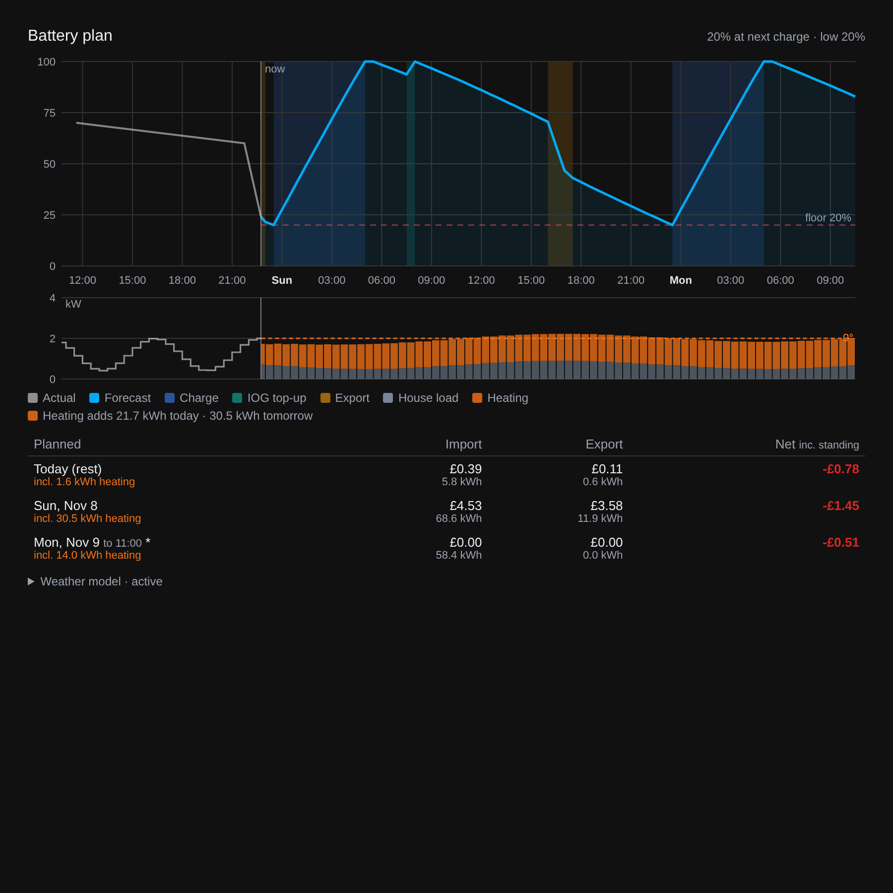

# Battery Plan

A Home Assistant integration that plans a home battery's overnight charge and evening exports against Octopus Energy tariffs, forecasts state of charge, and estimates what each day will cost or earn. It ships with a Lovelace card.



It plans and reports by default. It can **optionally** drive your inverter's grid setpoint and charge current, each with its own switch, both off until you turn them on (see [Control](#control-optional)).

## What it does

Every 5 minutes, and whenever rates or Intelligent Octopus dispatches change, it simulates the next 36 hours in half-hour slots:

- **Overnight charge window**: charges to your target, at full power or spread so it finishes shortly before the window ends (like a DVCC charge-current spreader). The house runs from grid during the window.
- **Intelligent Octopus Go dispatches**: planned dispatches outside the window are treated as full-rate top-ups (optional). A half hour the Octopus integration has confirmed (`started_dispatches`) counts in full, as Octopus bills it off-peak to its end even if the dispatch stops part way or started mid-slot.
- **Octoplus**: saving sessions export at a higher power. Free-electricity sessions charge at full power, and the battery is run down beforehand to make room. Each session (calendar event, usually an hour, even back to back) is free only up to **Free import per session** (default 16 kWh, house and car included): past it, at peak the battery stops charging and runs the house again, while where import is off-peak anyway (an IOG dispatch) it carries on at that rate. The import used so far in a session in progress comes from the Energy dashboard's grid meter (or the grid power sensor). **Power Ups** (a separate calendar) are free with no cap; an hour listed in both calendars, as the Octopus integration does for the weekend free hours, is treated as the capped session.
- **Exports**: one rule for every export. A kWh is exported when it earns at least your **export margin** (default 5p) more than keeping it would save: a smaller recharge in the charge window, house load not bought later, a dispatch refilling the battery at the off-peak rate, or nothing ahead of a free-electricity session (which refills it anyway, and costs nothing in the planned costs). Only the Intelligent Octopus dispatch in the half hour before the car's ready time (the ready-time entity) is counted on to refill exports: other dispatch times move or vanish, so the plan still charges in them but doesn't export ahead of them. The plan works this out from its own simulation, so it exports surplus energy and, where it pays, energy the house would otherwise use below the floor (e.g. at 42p while the overnight rate is 6.6p). Exports stop at the export floor of the time, which can be higher during the day (e.g. 25% from 05:25 to 22:25, 20% overnight); the house can still run the battery down to the minimum SOC. With **Inverter maximum output** set, each half hour's export is planned at no more than that less the house load, as the inverter feeds the house first. At equal prices the latest half hour is used, so a replan can still see a cancelled dispatch or session before anything goes out.
- **Reject a dispatch for an export** (optional): an Intelligent Octopus dispatch outside the charge window (e.g. one landing in the evening peak) is normally a top-up, so nothing is exported in it. With this on, the plan may export in it instead when that beats keeping the dispatch's cheap top-up by the margin; the EV charger is inhibited while exporting, so the car doesn't charge then (Octopus usually reschedules). Dispatches inside the overnight window are always kept.
- **Buy at peak to export more** (optional): by default exports never leave the house buying at peak rate before the window. With this on, they may when the export beats the peak price by the margin: first afterwards (the house imports once the battery runs out), then, if an export would still stop at the floor, in advance, but only within **Buy in advance up to** (default 3 h) before the run of well-paid half hours: nearest the export first, the house runs from grid with the battery resting, then the battery grid-charges in 2 kW steps (dearer, as charging loses ~7%). It never buys in a half hour that pays almost as much to export.
- **Buy, sell and buy back overnight** (optional): exports inside the overnight charge window, down to the night floor, and charges it back at the off-peak rate, when the export beats the margin (e.g. Agile Outgoing at ~18p against 6.6p). The battery must still reach the charge target by the window's finish-early time, and nothing is exported after it. With this on, the window charges at full power rather than spread: a spread charge leaves too little time to buy back much of what's sold (a replay of one night gave about a third of the gain). Inside the window the earliest half hours go first, to leave time to charge back, and it doesn't sell in half hours with an Intelligent Octopus dispatch (the car charging there would take the export). To control it, the overnight charge has to come from the charge schedule (**Charge overnight with the charge schedule** under Control), as an overnight schedule of its own would stop the battery discharging.
- **House load**: learned as a half-hourly profile from your power sensors' statistics (last N days), minus any excluded sensors such as an EV charger, or a flat figure. Half hours that aren't normal house load are left out: Intelligent Octopus dispatches and grid charging outside the charge window, and Octoplus free-electricity and saving sessions. A half hour that's affected every day (e.g. a daily 07:30 dispatch) is filled in from the half hours either side.
- **Weather-dependent load** (optional): learns how much your load rises in cold (and optionally hot) weather and adjusts the house load for the forecast temperature. See [Weather-dependent load](#weather-dependent-load-optional).
- **Costs**: planned import cost and export earnings per day, from your import and export rates. Import past the published rates is never priced: it's reported as unpriced (`unpriced_kwh`) and the card shows no net for that day. Free-session import within the cap costs nothing. Actual costs come from the Energy dashboard's grid cost statistics when it has priced grid meters (so they match it), otherwise from a grid power sensor × live rates. With the Energy dashboard, confirmed dispatch half hours are re-priced at off-peak in full (the dashboard prices each moment at the rate showing then, so the minutes before a dispatch was known go in at peak).

## Requirements

- Home Assistant 2025.4 or newer
- The [Octopus Energy](https://github.com/BottlecapDave/HomeAssistant-OctopusEnergy) integration (BottlecapDave): the planner reads its rate event entities, dispatching sensor and Octoplus calendars
- A battery state-of-charge sensor (any inverter)

## Installation

1. HACS → ⋮ → **Custom repositories** → add this repository's URL with type **Integration**.
2. Install **Battery Plan** and restart Home Assistant.
3. **Settings → Devices & services → Add integration → Battery Plan**. Only the Battery and Tariff sections need filling in: the SOC sensor, capacity and import rate events. Everything else has defaults you can change later under **Configure**.

The card is added to your dashboard resources automatically (and updated with each release). If a dashboard shows "Configuration error" right after an update, reload it or, in the mobile app, use **Settings → Companion app → Troubleshooting → Reset frontend cache**. Add it with **Add card → Battery Plan**, or:

```yaml
type: custom:battery-plan-card
entity: sensor.battery_plan_soc_at_next_charge
```

## Settings

| Section | Setting | Notes |
|:--|:--|:--|
| Battery | SOC sensor, usable capacity, charge target, export floor, optional daytime floor with start/end times, minimum SOC, inverter minimum SOC entity | Exports stop at the floor in force at the time; the plan lets the house use the battery down to the minimum. With the inverter's own minimum as an entity (e.g. Victron ESS minimum SoC) below it, exports still aim to end at the minimum SOC, but the forecast and costs let the house carry on from the battery down to the inverter's minimum before buying from grid (as it will); an inverter minimum above it is used for the whole plan |
| Tariff | Import rate events, export rate events, standing charge sensor | Pick the Octopus Energy `…_current_day_rates` **and** `…_next_day_rates` events for each meter |
| Overnight charging | Charge window from import rates; optional inverter schedule entities (start, duration, target SOC) and BMS consumed-Ah sensor; window start and length, full power or spread, max/min/make-up power, finish-early minutes, an optional "long balance" night, charge efficiency | With **Charge window from import rates** on, the window is the import rates' daily off-peak period (half hours at the lowest rate every day, ignoring dispatches), else schedule entities (e.g. Victron ESS schedule) override the window and target whenever they're available; the consumed-Ah sensor sizes spread charging from the BMS capacity |
| Export | Max export power, saving-session power, inverter maximum output (house load + export), limited-export power, export margin (p/kWh), buy at peak to export more, buy in advance up to (h), buy, sell and buy back overnight, reject a dispatch for an export, SOC tracking, hold the export for the last N minutes, discharge efficiency | The margin covers battery wear and forecast error; 4–5p is typical |
| House load | Power sensors (summed, e.g. AC loads per phase), sensors to exclude (e.g. EV charger), days of history, flat fallback | Uses 5-minute statistics where the recorder still has them, hourly otherwise |
| Weather-dependent load | Weather forecast, outdoor temperature sensor, weather-dependent load sensors, cooling on/off, days to learn from | All optional; see [Weather-dependent load](#weather-dependent-load-optional) |
| Intelligent Octopus & Octoplus | Dispatching sensor, whether dispatches charge the battery, ready-time entity, saving-session calendar, free-electricity calendar, free import per session (kWh, 0 = no cap), Power Up calendar | All optional. Use the Octopus integration's *free electricity session* calendar for the capped free hours and its *Power Up* calendar for Power Ups |
| Actual costs | Use Energy dashboard costs (on by default), grid power sensor (import positive), battery power sensor (charging positive), invert switches | Actual cost sensors appear if the Energy dashboard has priced grid meters or a grid power sensor is set. The battery power sensor makes the Battery action sensor more accurate |
| Control (optional) | Grid setpoint entity, charge current entity, charge schedule SOC entity, parked SOC and whether it also does the overnight charge, idle and charging setpoints, setpoint deadband (W), charge current deadband (A), battery voltage, stale timeout, MQTT heartbeat topic, EV charger allow switch (+ invert) | Nothing is written until the matching control switch is on |

Everything can be changed later under **Configure**.

## Entities

Entity IDs below assume the default name "Battery Plan".

| Entity | Description |
|:--|:--|
| `sensor.battery_plan_soc_at_next_charge` | Predicted SOC when the next charge window starts. Attributes hold the full plan: `forecast` (per half hour), `plan` (blocks), `days` (planned cost per day, with `unpriced_kwh` where rates aren't published), `free_sessions` (each session's start, end, kind, cap, planned free kWh, used so far and `until` = when free charging stops), `actual_today` (today's actual costs so far), `min_soc`, `load_profile_kw`, `load_masked_slots` (half hours left out of the load profile) |
| `sensor.battery_plan_lowest_soc_ahead` | Lowest SOC in the forecast |
| `sensor.battery_plan_next_action` | `charge`, `export`, `iog`, `saving`, `hold`, `grid` or `self`, with `start`/`end` attributes |
| `sensor.battery_plan_planned_export` | Planned export over the horizon (kWh) |
| `sensor.battery_plan_net_today_estimate` | Today's actual so far (if a grid power sensor is set) plus the plan for the rest of today, minus standing charge |
| `sensor.battery_plan_net_tomorrow_plan` | Tomorrow's planned export earnings minus import cost and standing charge |
| `sensor.battery_plan_import_cost_today`, `…_export_earnings_today`, `…_net_today`, `…_net_yesterday` | Actual costs: from the Energy dashboard's grid cost and compensation statistics (`source: energy_dashboard`, refreshed every 5 minutes), or grid power × live rates (`source: grid_power`). Net figures subtract the standing charge. `dispatch_reprice` is what was taken off the dashboard's import cost for confirmed dispatch half hours |
| `sensor.battery_plan_dispatch_hours_before_ready` | Hours of planned IOG dispatch in the 24 h before the ready time, with overlaps merged (needs dispatching + ready-time entities) |
| `binary_sensor.battery_plan_final_slot_scheduled` | On when a dispatch covers the half hour before the ready time |
| `sensor.battery_plan_battery_action` | What the battery is actually doing now (`export`, `charge`, `iog`, `saving`, `hold`, `grid`, `self`), from grid/battery power and the plan. Its history gives the card's past bands |
| `sensor.battery_plan_target_grid_setpoint` | Grid setpoint the controller wants now (W): always computed, written only when Control is on |
| `sensor.battery_plan_target_charge_current` | Charge current limit the controller wants now (A) |
| `sensor.battery_plan_target_charge_soc` | Charge schedule target SOC the controller wants now (%). Only with a charge schedule SOC entity set |
| `sensor.battery_plan_control_status` | `disabled` (dry run), `active` or `fallback`, with a `reason` attribute |
| `sensor.battery_plan_weather_load_today`, `…_tomorrow` | Estimated heating/cooling load (kWh), with half-hourly `slots` (kW and forecast temperature). Only with a weather entity set |
| `sensor.battery_plan_heating_sensitivity` | Diagnostic: learned kW per °C, with the balance point, fit quality, days learned from and `status` (`active` or `not_enough_data` with a `reason`) |
| `switch.battery_plan_grid_setpoint_control` | Writes the grid setpoint (and the EV charger switch). Off by default; created when a setpoint entity is set. Installs from before 0.4.0 keep the id `switch.battery_plan_control` |
| `switch.battery_plan_charge_current_control` | Writes the charge current limit. Off by default; created when a charge current entity is set |
| `select.battery_plan_override` | `auto` (follow the plan), `hold`, `max_export`, `limited_export`, `saving`, `zero` or `custom`. Export overrides still stop at the floor |
| `number.battery_plan_custom_setpoint` | Grid setpoint (W) used by the `custom` override |
| `binary_sensor.battery_plan_ev_inhibit` | On while exporting 200 W or more, so an EV charger doesn't drain the battery. Inside the charge window (buy, sell and buy back) only while no Intelligent Octopus dispatch is under way, so the car's own charging isn't blocked |

## Weather-dependent load (optional)

Pick a weather entity with hourly forecasts (e.g. `weather.home`) under **Weather-dependent load** and the plan adjusts the house load for the forecast temperature:

- **What it learns from**: your weather-dependent load sensors if you set them (e.g. heat pump heating input power), otherwise the whole-house load. Outdoor temperature comes from your sensor if set, otherwise the weather entity's recorded temperature.
- **Model**: a baseline for each hour of the day (so your own setback and boost times are kept) plus one sensitivity in kW per °C below a heating balance point, and optionally above a cooling one. Balance points are learned (10–18 °C heating, 18–26 °C cooling). The outdoor temperature is smoothed over the previous hours, as buildings respond slowly. Dispatches, Octoplus sessions and, for whole-house learning, the charge window are left out.
- **Forecast**: each half hour's load = the 7-day schedule + sensitivity × how much colder (or hotter) the forecast is than the same hour over those 7 days.
- **Only when supported by the data**: at least 7 days, enough hours past the balance point, a sensible sensitivity, and the weather explaining at least 3% of the hour-to-hour variation. Otherwise the status says why and the plan uses the plain schedule. A gas-heated home or a mild month just gets "not in use yet".
- **Hot water** usually runs off-peak and barely depends on the weather, so leave its sensors out.

The SOC chart marks the export floor (dashed, stepping between day and night, also over the history) and the minimum SOC (dotted). The cost table's today row covers the whole day: actual so far plus the plan for the rest (hover for the split). Below it, **Planned actions** lists the plan's blocks with their energy, end SOC and value (export earnings less import cost, house load included); turn it off with `show_actions: false`. The card then shows a load strip under the SOC chart (base load in grey, heating in orange, cooling in blue, forecast temperature dashed, past actual load as a line), a "Heating adds … kWh" line, the heating included in each day's cost row, and a collapsed **Weather model** panel with daily load against temperature and the fitted line.

## Control (optional)

Every 30 seconds, and whenever the plan changes, the integration works out:

- **Grid setpoint**: in export slots, with SOC tracking on, the power that brings the battery to the plan's SOC at the end of the slot, after the live house load (so a big load shrinks the export instead of overshooting); for the last few minutes of the slot (**Hold the export for the last**, default 5) it's held rather than tracked to the end, where a small SOC difference over a few minutes would taper or surge. Without SOC tracking, the planned export power. The setpoint asks for the full export even with an inverter limit set; the inverter delivers what it can. Saving sessions export at the saving-session power; hold and charge slots bought in advance for an export set it to the live house load, plus the planned charge power (so the battery rests or grid-charges); charge-window, IOG and other hold slots use the *charging setpoint*; otherwise the *idle setpoint*. The override select replaces this when not `auto`.
- **EV charger**: if an allow switch is set (e.g. a GX relay wired to a Zappi eSense input), it's turned off while the EV inhibit sensor is on and back on otherwise.
- **Charge current limit**: the spread rate (energy still needed ÷ time to finish + make-up, converted with the battery voltage) inside the charge window. Outside it, during an Intelligent Octopus dispatch, the same spread so the battery fills the finish-early minutes before the slot ends instead of at full power. In a free-electricity session, and in a charge bought ahead of an export, the plan's charge rate (so a capped session stops at the cap). Otherwise the maximum. With a consumed-Ah sensor, the energy still needed comes from the BMS capacity (consumed Ah ÷ (100 − SOC)), as Victron DVCC spreader flows do.
- **Charge schedule SOC** (optional, written with the charge current): the target of an inverter charge schedule left on all day, such as Victron ESS schedule 5 (00:00 for 1440 minutes, every day). Raised to the charge target during an Intelligent Octopus dispatch, and to the plan's SOC at the end of the charge during a free-electricity session or a charge bought ahead of an export; otherwise parked below the battery's SOC (default 0%), so the schedule does nothing. Charging this way starts a real scheduled charge, so DC chargers that only follow ESS schedules (e.g. a Flatpack bank) join in, and the charge current limit sets the rate. The overnight window is left to your own schedules, which stay as a backstop if Home Assistant is down, unless **Charge overnight with the charge schedule** is on: then it is raised to the charge target in the window too (parked only while the plan exports in it), stays raised if control stops inside the window, and the plan being stale also leaves it raised. Without a backstop, use the heartbeat watchdog to raise it if Home Assistant stops overnight. Turn off any automation that switches the same schedule on and off.
  - On a Victron GX, set that schedule's **Self-consumption above limit** to **PV & battery** (allow discharge). Otherwise an active schedule caps battery discharge to the PV power even above its target, so without solar the battery would not run the house or export all day.
  - When schedules overlap, the GX uses the first active one in slot order, not the highest target. Put this one after your overnight schedules (e.g. schedule 5), so they win inside the window.

These always appear as sensors, so you can compare them with what your current setup does before handing over. The two switches write them to the number entities you chose (e.g. Victron's ESS AC power setpoint and DVCC max charge current), so you can hand over the charge current alone and keep another tool on the setpoint, or the other way round.

Safeguards:

- Live SOC at or below the export floor → idle setpoint, whatever the plan says.
- Export capped at your maximum (or saving-session) export power.
- Plan stale or unavailable → **fallback** idle setpoint (the charge current still spreads, as it only needs SOC). SOC unavailable → idle setpoint and maximum charge current.
- Turning a switch off, unloading the integration or stopping Home Assistant → what that switch controlled is handed back once: idle setpoint and EV charger allowed, or maximum charge current.
- Changes within the deadbands aren't written (setpoint default 100 W, charge current default 10 A, schedule SOC 1%), to keep writes to the inverter down.
- Optional MQTT heartbeat: `on` every 30 s while controlling, `off` when stopped. [`docs/node-red-watchdog.json`](docs/node-red-watchdog.json) is a Node-RED flow for a Victron GX, on its own tab, that resets the grid setpoint to −50 W and the DVCC charge current to its maximum if the heartbeat stops for 2 minutes (for example, if Home Assistant crashes). Set its DVCC value for your system (maximum charge kW × 1000 ÷ battery V; it ships with 344 A).

Charging itself is left to your inverter's own schedule (e.g. Victron ESS scheduled charge); the integration only sets the charge current. Turn off any other automation that writes the same setpoint before enabling control, or they'll fight.

### Forecast format

Each `forecast` item is one half-hour slot (`t` is the slot's end):

| Key | Meaning |
|:--|:--|
| `t` | ISO time (UTC) |
| `soc` | SOC at `t` (%) |
| `kw` | Battery power (+ charging, − discharging) |
| `exp` | Grid export power (kW) |
| `ik`, `ek` | Grid import / export energy in the slot (kWh) |
| `mode` | `self`, `charge`, `hold`, `iog`, `export`, `saving`, `grid` |
| `rate`, `ip` | Export and import price (p/kWh) |
| `ld` | Expected house load (kW), including any weather adjustment |
| `wh`, `wc`, `tf` | Heating and cooling part of the load (kW) and forecast temperature (°C), with the weather model on |
| `fl` | Export floor in force (%) |

Other planners can publish the same attributes to use the card.

## Limitations

- Free-session caps are checked against the planned import plus what the grid meter has recorded so far (refreshed every 5 minutes), so an unplanned load such as a car charging at peak can use up a session's cap sooner than planned.
- Greedy, not a full optimiser: it raises exports one half hour at a time, best price first, judging each on the whole plan's value. Charging overnight beyond the target to export more isn't considered.
- No solar forecast yet.
- The weather model's sensitivity is shared across the day; it's learned from at most the recorder's history (default 10 days for raw weather-entity temperatures, longer with an outdoor sensor's statistics).
- One charge window per day.
- Dispatches are assumed to charge the battery at full power. Turn that off if your setup doesn't.

## Development

```bash
pip install -r requirements_test.txt
TZ=Europe/London pytest
```

`tests/test_planner.py` covers the planner alone and runs without Home Assistant: `pytest --noconftest tests/test_planner.py`. The other tests need `pytest-homeassistant-custom-component`, which runs on Linux or macOS (on Windows, use WSL).

## Licence

MIT
